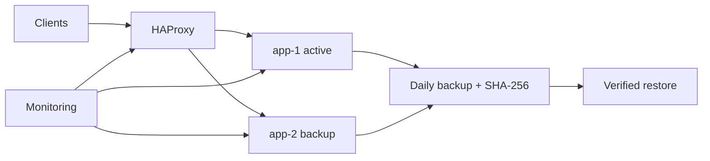

# InfraFoundry

An automated high-availability Linux laboratory combining Ansible configuration, secure networking, HAProxy health-based failover, monitoring-ready services, checksum-verified backups, and disaster recovery.



## Automation scope

- Inventory separates load balancer, application, and monitoring networks
- Baseline role installs firewall, fail2ban, time sync, and SSH hardening
- HAProxy uses `/health` checks and an explicit backup backend
- Application deployment uses serial updates to retain capacity
- Daily compressed backups include SHA-256 manifests and retention
- The executable lab demonstrates failover and rejects tampered backups

### Measured disaster-recovery simulation

| Signal | Result |
| --- | ---: |
| Active node after failover | `app-2` |
| Service after failure | `service-ready` |
| Checksum verified | Yes |
| Restore time | 0.104 ms |
| Test coverage | 100% |

The committed [result](benchmarks/results.json) measures the local HA model; real VM recovery time depends on the target infrastructure and must be measured after deployment.

## Run the proof locally

```bash
python -m venv .venv
source .venv/bin/activate
pip install -e '.[dev]'
ruff check .
pytest
infrafoundry-demo
```

To provision disposable lab VMs, update `ansible/inventory/lab.yml` and run `ansible-playbook -i ansible/inventory/lab.yml ansible/site.yml --check --diff` before applying.
